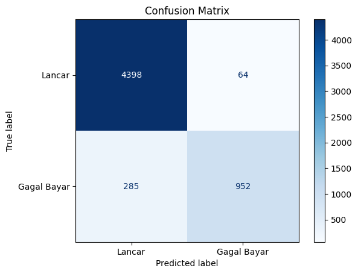
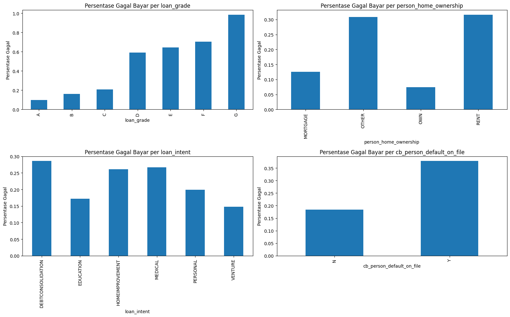
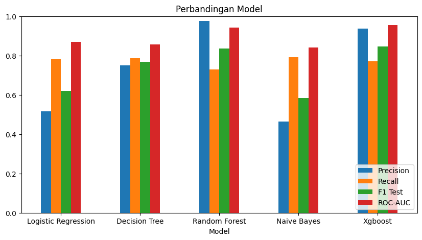
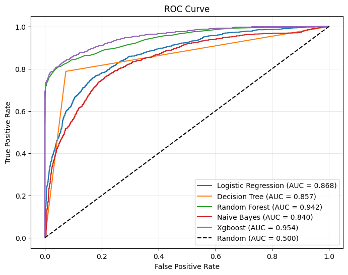
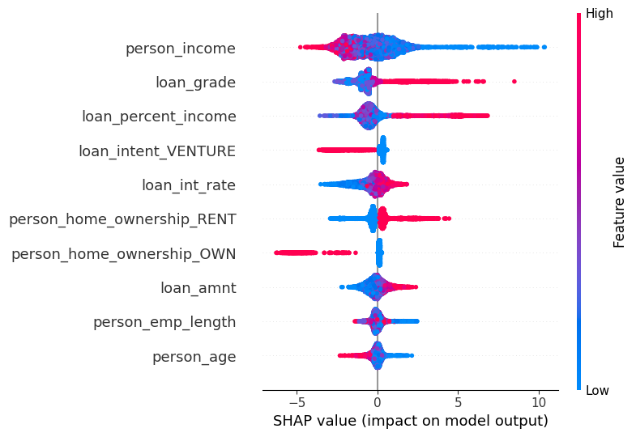

# Analisis Credit Risk: Prediksi Gagal Bayar Pinjaman


> Model klasifikasi untuk mendeteksi calon peminjam berisiko **gagal bayar** sebelum pinjaman disetujui.
> **XGBoost** mencapai **ROC-AUC 0.954** dan **F1-Score 0.845** pada data uji.

---

## 📌 Masalah Bisnis

Lembaga pinjaman merugi setiap kali menyetujui pinjaman yang akhirnya macet. Proyek ini membangun model yang memprediksi `loan_status` (**1 = gagal bayar**, **0 = lancar**) dari profil peminjam dan karakteristik pinjaman, sehingga analis kredit bisa memprioritaskan pemeriksaan pada pengajuan yang berisiko tinggi.

## 🏆 Hasil Utama

| Metrik (data uji) | Nilai |
|---|---|
| ROC-AUC | **0.954** |
| F1-Score | **0.845** |
| Precision (gagal bayar) | 0.937 |
| Recall (gagal bayar) | 0.770 |
| Accuracy | 0.939 |

- **Precision 94%**: dari peminjam yang ditandai berisiko, 94% memang gagal bayar, jadi sedikit nasabah baik yang salah ditolak.
- **Recall 77%**: model menangkap sekitar 3 dari 4 peminjam yang benar-benar gagal bayar.
- Accuracy bukan acuan utama, karena model yang selalu menebak "lancar" pun sudah mendapat 78%.

<p align="center"></p>

## 📊 Dataset

[Credit Risk Dataset (OpenML #43454)](https://www.openml.org/search?type=data&sort=runs&id=43454): **32.581 baris**, 11 fitur + 1 target.

| Kelompok | Fitur |
|---|---|
| Profil peminjam | `person_age`, `person_income`, `person_home_ownership`, `person_emp_length` |
| Karakteristik pinjaman | `loan_intent`, `loan_grade`, `loan_amnt`, `loan_int_rate`, `loan_percent_income` |
| Riwayat kredit | `cb_person_default_on_file`, `cb_person_cred_hist_length` |
| **Target** | `loan_status` |

Data **tidak seimbang**: 78% lancar dan 22% gagal bayar.

## 🔎 Insight EDA

<p align="center"></p>

- **Loan grade** adalah sinyal terkuat: tingkat gagal bayar naik dari **10% (grade A)** menjadi **98% (grade G)**.
- Peminjam yang **pernah gagal bayar** sebelumnya berisiko 2× lebih tinggi (37.8% vs 18.4%).
- Penyewa rumah (**RENT**) gagal bayar 31.6%, jauh di atas pemilik rumah (**OWN**) yang hanya 7.5%.
- `loan_percent_income` dan `loan_int_rate` berkorelasi positif dengan gagal bayar; pendapatan berkorelasi negatif.

## ⚙️ Alur Kerja

```
Data mentah (32.581)
  → Validasi: 165 duplikat, 7 data tidak logis (umur 144 th, lama kerja 123 th), 3.914 nilai kosong dihapus
  → Data bersih (28.495 baris)
  → Encoding: ordinal (loan_grade, default_on_file) + one-hot (home_ownership, loan_intent)
  → Split 80/20 stratified → StandardScaler (fit di train saja)
  → Bandingkan 5 model → Evaluasi → Interpretasi SHAP
```

Ketidakseimbangan kelas ditangani dengan `class_weight='balanced'` dan prior seimbang pada Naive Bayes.

## 🤖 Perbandingan Model

| Model | Precision | Recall | F1 Test | F1 Train | ROC-AUC |
|---|---|---|---|---|---|
| **XGBoost** | 0.937 | 0.770 | **0.845** | 0.953 | **0.954** |
| Random Forest | 0.976 | 0.729 | 0.835 | 1.000 | 0.942 |
| Decision Tree | 0.749 | 0.787 | 0.768 | 1.000 | 0.857 |
| Logistic Regression | 0.516 | 0.781 | 0.621 | 0.621 | 0.868 |
| Naive Bayes | 0.463 | 0.792 | 0.585 | 0.579 | 0.840 |

**XGBoost dipilih** karena F1 dan ROC-AUC tertinggi, dengan selisih F1 train–test paling kecil di antara model berbasis tree (0.108). Random Forest dan Decision Tree mencapai F1 train 1.000, tanda overfitting.

<p align="center">
  
  
</p>

## 🧠 Interpretasi Model (SHAP)

<p align="center"></p>

Faktor yang paling mendorong prediksi **gagal bayar**:
1. **Pendapatan rendah**
2. **Loan grade buruk**
3. **Porsi pinjaman besar** dibanding pendapatan
4. **Menyewa rumah**

Sebaliknya, **memiliki rumah sendiri** dan pinjaman untuk **usaha (venture)** menurunkan risiko. Temuan ini konsisten dengan hasil EDA.

## 💡 Rekomendasi Bisnis

- Gunakan model sebagai **alat bantu analis kredit**, bukan pengganti keputusan manusia.
- Pengajuan dengan skor risiko tinggi masuk ke **pemeriksaan manual** yang lebih ketat.
- Perhatikan **grade D ke bawah** dan **rasio pinjaman/pendapatan tinggi** sebagai red flag.
- **Pantau performa model secara berkala**, karena pola peminjam bisa berubah.

**Keterbatasan:** sekitar 23% peminjam gagal bayar masih lolos terdeteksi. Langkah lanjut: tuning threshold untuk menaikkan recall, hyperparameter tuning, dan validasi silang.

## 🚀 Cara Menjalankan

```bash
git clone https://github.com/mikazuki14/<nama-repo>.git
cd <nama-repo>
pip install numpy pandas matplotlib seaborn scikit-learn xgboost shap jupyter
jupyter notebook Credit_Risk_Final.ipynb
```

> Sesuaikan path `pd.read_csv(...)` di notebook menjadi `"credit_risk_dataset.csv"`.

## 📁 Struktur Proyek

```
├── Credit_Risk_Final.ipynb   # Notebook analisis lengkap
├── credit_risk_dataset.csv   # Dataset
├── images/                   # Grafik untuk README
└── README.md
```

---
[GitHub](https://github.com/mikazuki14)
